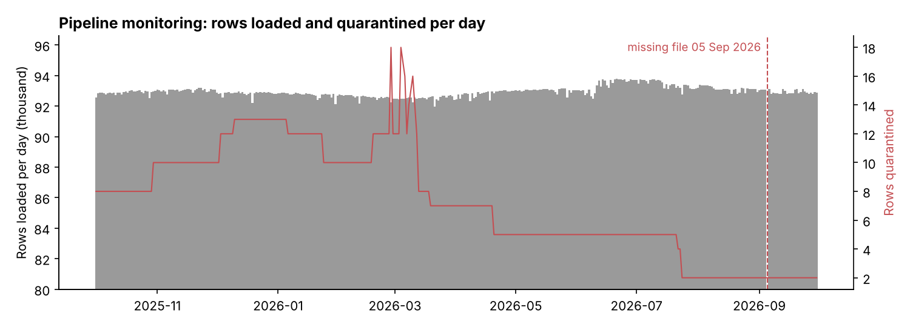
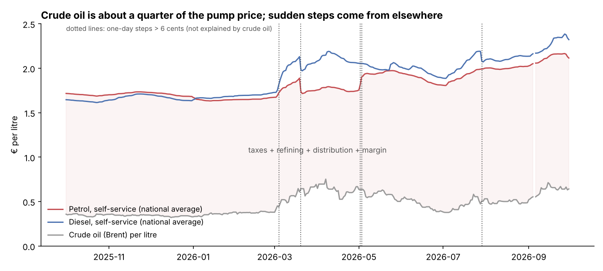
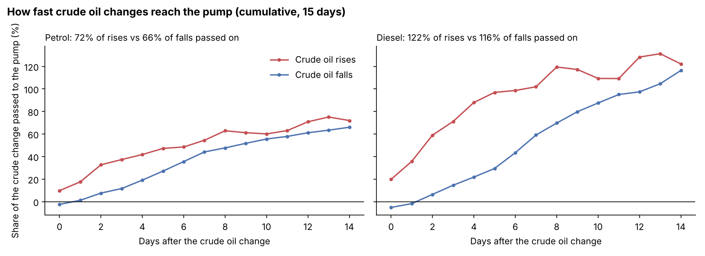

# Italian Fuel Price Data Pipeline

[](https://github.com/Amirhatamian/italy-fuel-etl/actions/workflows/ci.yml)

An ETL pipeline that loads **every daily fuel price published in Italy** into a PostgreSQL data warehouse, checks its quality, and answers a classic question on top: *do pump prices rise faster than they fall?*

**One year loaded (1 Oct 2025 – 30 Sep 2026):** 364 daily files · **33.8 million prices** · 23,545 stations · 59 fuel names · plus daily crude oil and EUR/USD. 2,662 rows (0.008%) quarantined, 1 missing file detected, 0 duplicates after repeated runs.

```
 MIMIT daily files ─┐                                   ┌─ dim_date ─┐
 (quarterly archive)│   ┌──────────┐   ┌───────────┐    ├─ dim_station (+ dim_region)
 Station registry ──┼──▶│ extract  │──▶│ transform │──▶ ├─ dim_fuel ─┼─▶ fact_price   (33.8 M rows)
 ECB EUR/USD ───────┤   │ (cached) │   │ validate  │    │            └─▶ fact_market
 Brent crude ───────┘   └──────────┘   └─────┬─────┘    │
                                             │          └─▶ marts: v_price_clean, mart_daily_national,
                              bad rows ─▶ etl_quarantine        mart_region_monthly, mart_market_daily
                              every run ─▶ etl_run, etl_loaded_file (SHA-256 per file)
```

## What makes it a real pipeline

| Feature | How |
|---|---|
| **Idempotent loads** | Each file's SHA-256 is stored. Same file again → skipped (tested: re-running a quarter changed 0 rows). A republished file → that day is replaced. |
| **One transaction per day** | A crash in the middle leaves nothing behind for that day (covered by a test). |
| **Quarantine, not silent drops** | Every rejected row is kept in `etl_quarantine` with its line number and the reason. |
| **Schema-change protection** | An unexpected header stops the load of that file with a clear error instead of loading wrong columns. |
| **Data-quality report** | `python -m etl check`: missing days, day-to-day volume changes above 20%, quarantine by reason, stations missing from the registry, last runs. `--strict` exits with an error code for schedulers. |
| **Run log** | Every command writes to `etl_run`: start/end, status, rows read/loaded/quarantined, message. |
| **Business rules in the marts, not in the load** | The warehouse keeps every valid price as published; staleness, outliers and the Livigno duty-free zone are handled in `v_price_clean`, with thresholds in `config.yaml`. |
| **Config + environment** | `config/config.yaml`, overridable with environment variables (`DATABASE_URL`, …). |
| **Tests + CI** | 38 tests (pytest): parsing and validation rules, and integration tests on a throwaway PostgreSQL database. GitHub Actions runs them on every push. |
| **Docker** | `Dockerfile` and `docker-compose.yml` (PostgreSQL + pipeline). |

### Real problems in the source files, handled by the pipeline

| Problem | Handling |
|---|---|
| Line 1 is a title (`Estrazione del 2026-07-01`), not the header | Parsed as the file date |
| **Separator changed** from `;` (2025) to `\|` (2026) | Detected per file |
| **A missing day** (5 Sep 2026 is not in the archive) | Reported by `check`; shown in the monitoring chart |
| Station names containing `" \| gestori.prezzibenzina.it"`: the separator inside a value | Removed before splitting (109 registry rows) |
| 2,662 impossible prices (e.g. €0.001 or €9.99) | Quarantined |
| 1,349 stations report prices but are not in the current registry (closed during the year) | Kept, flagged `in_registry = false` |
| 59 fuel names (Blue Diesel, HiQ Perform+, HVOlution…) | Mapped to 9 comparable groups in `dim_fuel` |
| Crude oil and exchange rate missing on weekends | Last known value carried forward in `mart_market_daily` |



## Analysis: do pump prices rise faster than they fall?

"Rockets and feathers": pump prices are often said to shoot up when crude oil rises and drift down slowly when it falls. Using the warehouse, I regressed the daily change in the national average self-service price on the **rises and falls of crude oil** (Brent, converted to € per litre) on the same day and the 14 days before, with Newey–West standard errors ([`analysis/rockets_and_feathers.py`](analysis/rockets_and_feathers.py)).



**Five one-day steps of 6–15 cents** (e.g. **−15 cents on 20 March 2026 for both fuels while crude oil rose**) are not explained by crude oil and are most likely changes in fuel excise duty. They are excluded from the main model and kept in a robustness check.



| Fuel | Passed on within 6 days: crude **rise** | crude **fall** | p-value | Within 15 days: rise | fall | p-value |
|---|---|---|---|---|---|---|
| Petrol | 47% | 27% | 0.29 | 72% | 66% | 0.51 |
| Diesel | **97%** | **29%** | **0.09** | 122% | 116% | 0.68 |

**Findings**
- **Over 15 days, pass-through is symmetric**: rises and falls of crude oil end up in pump prices to the same extent.
- **Rises seem to arrive faster than falls**, especially for diesel (97% vs 29% within 6 days), but with one year of data the difference is **not statistically significant** (p = 0.09). A longer history (the archives go back to 2015) would answer it.
- **Crude oil is only about 25% of the petrol price on average**; the rest is taxes, refining, distribution and margin. Diesel passes on more than 100% because its price follows the diesel market, which moves more than crude oil.
- **Including the tax steps would have given a misleading result** (falls apparently passed on faster): cleaning the events mattered more than the model.

## How to run

**Local PostgreSQL**
```bash
git clone https://github.com/Amirhatamian/italy-fuel-etl.git
cd italy-fuel-etl
pip install -r requirements.txt
createdb fuel_dw
export DATABASE_URL=postgresql:///fuel_dw
python -m etl init-db
python -m etl load-registry --file data/registry/anagrafica_impianti_attivi_20261102.csv
python -m etl backfill --from 2025-4 --to 2026-3          # ~25 min, 33.8 M rows, ~3.3 GB
python -m etl load-market --start 2025-09-01 --end 2026-11-02
python -m etl refresh-marts
python -m etl check
python analysis/rockets_and_feathers.py
```
or `make all`, then `make analysis`.

**Docker**
```bash
docker compose up -d db
docker compose run --rm etl init-db
docker compose run --rm etl load-registry --file data/registry/anagrafica_impianti_attivi_20261102.csv
docker compose run --rm etl backfill --from 2025-4 --to 2026-3
```

**Daily schedule:** `python -m etl run-daily` downloads today's registry and prices from MIMIT, the latest market data, and refreshes the marts. Run it every morning after 8:00, e.g. with cron: `15 9 * * * cd /path/to/italy-fuel-etl && python -m etl run-daily && python -m etl check --strict`.

**Tests:** `python -m pytest` (integration tests run when `TEST_DATABASE_ADMIN_URL` points to a PostgreSQL server).

## Data sources

| Source | Content | Licence |
|---|---|---|
| [MIMIT open data](https://www.mimit.gov.it/it/open-data/elenco-dataset/carburanti-archivio-prezzi) (Italian Ministry of Enterprises) | Daily price at 8:00 of every fuel station; station registry | IODL 2.0 |
| [Release `data-v1`](https://github.com/Amirhatamian/italy-fuel-etl/releases/tag/data-v1) of this repo | Mirror of the 4 quarterly MIMIT archives used here | IODL 2.0 |
| [ECB Data Portal](https://data.ecb.europa.eu/) | Daily EUR/USD reference rate | ECB terms |
| [datasets/oil-prices](https://github.com/datasets/oil-prices) | Daily Brent crude price (from the US EIA) | Public domain (EIA) |

## Files

| Path | Content |
|---|---|
| `etl/extract.py` | Downloads (with cache), archive reading, ECB and Brent |
| `etl/transform.py` | Parsing and validation rules, quarantine reasons, fuel groups |
| `etl/load.py` | Idempotent loads, run log, dimensions, facts |
| `etl/quality.py` | Data-quality report |
| `etl/__main__.py` | Command-line interface (`python -m etl --help`) |
| `sql/01_schema.sql` | Star schema and ETL bookkeeping tables |
| `sql/02_seed_regions.sql` | Province → region → macro-area |
| `sql/03_marts.sql` | Cleaning rules and analysis views |
| `tests/` | Unit and integration tests |
| `analysis/` | Rockets-and-feathers analysis and its results |
| `config/config.yaml` | Sources, database, validation and business-rule thresholds |

## Tools

Python · PostgreSQL (star schema, materialized views, COPY) · SQL · pandas · statsmodels · pytest · GitHub Actions · Docker
